# 大肥鱼 AI 虚拟主播 · 图文教程

从零开始，在一台 Windows 电脑上搭一个能在抖音开播的 AI 虚拟主播：观众发弹幕，大肥鱼用自己的声音回答，嘴型跟着声音动，台词显示成字幕，还能点歌。

这份文档有两种用法：

- **自己照着做**：按第 2 节到第 9 节一步步来，每一步都有截图。
- **交给 AI 帮你配**：把下面这段话发给能操作电脑的 AI 助手（Claude Code、Codex、Cursor 等，要在本仓库的文件夹里打开）。它会按第 1 节的规则执行命令、修改配置、做检查，需要你亲手操作的地方会停下来告诉你怎么做。

```text
请完整阅读 docs/图文教程.md，遵守第 1 节「给 AI 助手的规则」，
从第 2 节开始，帮我在这台 Windows 电脑上把大肥鱼 AI 虚拟主播配置到可以开播。
每一步先检查是否已经完成，完成了就跳过；需要我亲手操作的步骤（标了 🙋），停下来告诉我具体点哪里。
最后运行 tools\check_setup.py --online，把结果告诉我。
```

截图里标了「示意界面」的图（安装程序、命令行、OBS、直播伴侣、申请 Key 的网页）是画出来的，帮你理解大概长什么样，实际界面以软件为准。管理后台的截图是真实截图。

---

## 1. 给 AI 助手的规则

如果你是正在执行这份文档的 AI 助手，请遵守以下规则。

**环境**
- 系统是 Windows 10 或 11。命令用 PowerShell 执行，工作目录是本仓库根目录（下面简称「项目目录」）。
- 项目里的 Python 一律用 `.venv\Scripts\python`，不要用系统 Python 装依赖。
- Windows PowerShell 5.1 运行含中文的 `.ps1` 脚本时，文件必须是带 BOM 的 UTF-8，否则会乱码出错。最省事的做法是逐条执行命令，不要写成脚本文件。

**执行方式**
- 每一步按「检查 → 执行 → 验证」进行。检查发现已经完成的，直接跳过。
- 标了 🙋 的操作必须由用户完成，比如注册账号、申请 Key、在 UAC 弹窗点「是」、安装证书、登录直播伴侣、在 OBS 和直播伴侣里点按钮、点「开始直播」。到这些步骤时，用一两句话告诉用户点哪里，等用户说做完了，再验证、继续。
- 每完成一步，用一句话告诉用户结果。遇到报错先看第 10 节，不要自己反复重装。

**Key 的处理**
- Key 就是密码。优先让用户自己粘贴：大模型 Key 粘贴到后台，Fish Key 粘贴到 `config.json`。用户直接把 Key 发给你的话，你可以帮忙写进 `config.json`。
- 不要在输出、日志或截图里显示 Key 的完整内容，最多显示长度或前 4 位。
- 修改 `config.json` 之前，先确认管理后台已经关掉（端口 8081 没有被占用）。后台开着时点「保存配置」，会把文件里的改动覆盖掉。
- 不要把填了 Key 的 `config.json` 提交到 git，也不要上传到任何地方。

**禁止的操作**
- 不要运行 `2-1.强制更新至主线版本（得先安装git）.bat`。它会执行 `git reset --hard`，把用户的修改全部清掉。
- 不要把 8081、8082、12345、5500、8888 这些端口映射到公网，或者转发给外部访问。
- 不要替用户点「开始直播」，也不要在用户直播期间关掉 OBS、虚拟摄像机或直播伴侣。
- 不要改系统代理以外的系统设置，不要关杀毒软件或防火墙，除非用户明确同意。

**完成标准**
1. `.venv\Scripts\python tools\check_setup.py --online` 最后一行是「全部通过」。
2. 用户开播后在直播间发一条弹幕，大肥鱼会用声音回答，画面上有字幕。

---

## 2. 先看懂它是怎么工作的

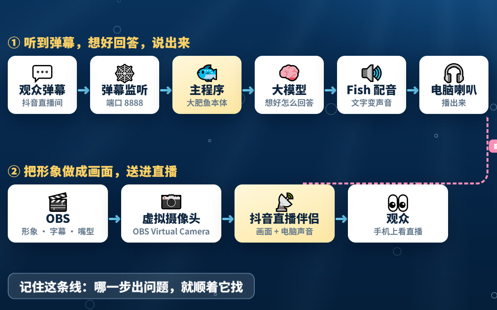

```text
观众弹幕 → 弹幕监听程序（8888）→ 主程序（8082）→ 大模型回答 → Fish Audio 配音 → 电脑扬声器播放
                                                   ↓
     OBS 浏览器来源：海底场景 + Live2D 形象 + 字幕（5500）+ 口型（12345）→ 虚拟摄像机 → 抖音直播伴侣 → 观众
```

| 端口 | 是什么 | 怎么启动 |
|---|---|---|
| 8888 | 弹幕监听程序 | 以管理员身份运行 `tools\DouyinBarrageGrab\WssBarrageServer.exe` |
| 8081 | 管理后台（WebUI） | 双击 `启动WebUI管理后台.bat` |
| 8082 | 主程序 | 后台右下角「操作 → 一键运行」，或者双击 `一键启动主播程序.bat`（两种只能选一种） |
| 12345 | Live2D 画面（OBS 要用的网页） | 主程序启动后自动提供 |
| 5500 | 台词字幕服务 | 双击 `启动字幕和口型.bat`（口型服务会一起启动） |

角色的声音是从**电脑扬声器**播放出来的，OBS 的虚拟摄像机只传画面，不传声音。所以直播伴侣要单独采集电脑的声音，也就是开启「扬声器」。这是最多人卡住的地方。

---

## 3. 第一步：准备

### 3.1 抖音账号 🙋

- 账号要完成实名认证。
- 电脑开播要用「抖音直播伴侣」，它需要**电脑开播权限**。官方文档写的门槛是 1000 粉丝，具体以直播伴侣里的提示为准。
- 打开直播伴侣官网 <https://streamingtool.douyin.com>，下载 PC 版，安装后登录。

### 3.2 装软件

| 软件 | 用途 | 安装命令（PowerShell） |
|---|---|---|
| Python 3.11 | 运行主程序 | `winget install -e --id Python.Python.3.11` |
| FFmpeg | 点歌切歌、读取歌曲时长 | `winget install -e --id Gyan.FFmpeg` |
| OBS Studio | 把角色画面做成虚拟摄像头 | `winget install -e --id OBSProject.OBSStudio` |
| Git | 下载代码和模型（可选，也可以下载 ZIP） | `winget install -e --id Git.Git` |

如果不用 winget，到官网下载安装包也一样。装 Python 时，第一个界面最下面一定要勾上 **Add python.exe to PATH**：

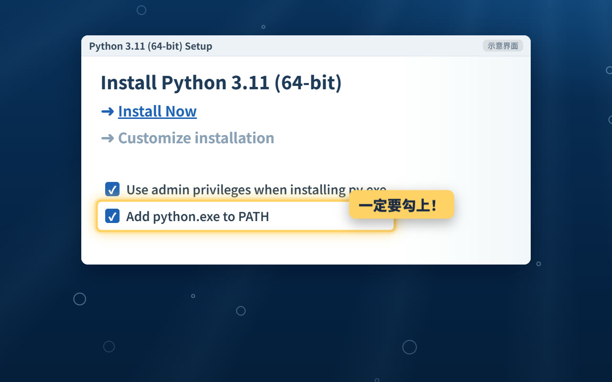

**验证**：装完**重新打开**一个 PowerShell 窗口，然后运行：

```powershell
py -3.11 --version      # 显示 Python 3.11.x
ffmpeg -version         # 第一行显示 ffmpeg version ...
```

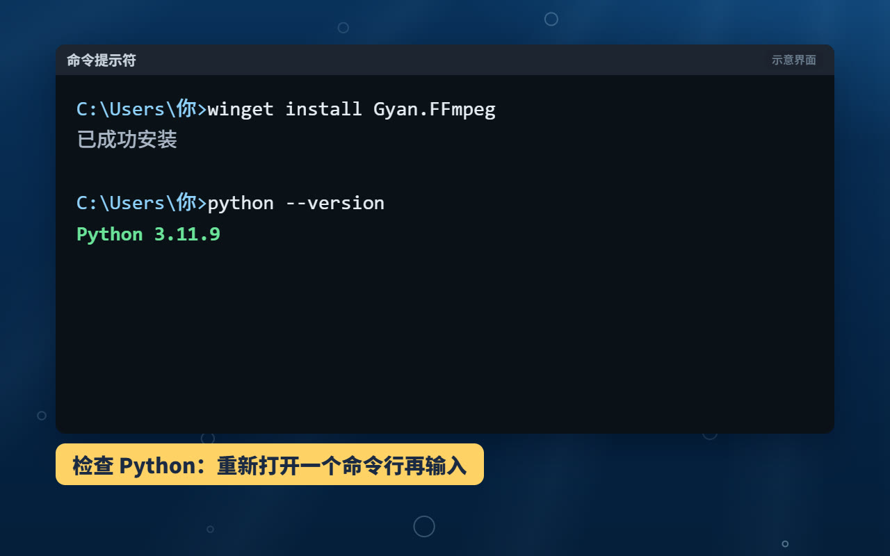

`py` 找不到的话，改用 `python --version`。如果还是不行，或者显示的不是 3.11，就重新安装 Python，并勾上 PATH。

---

## 4. 第二步：下载程序、安装依赖

挑一个路径里**没有空格**的文件夹，比如 `D:\`，然后在 PowerShell 里运行：

```powershell
cd D:\
git clone https://github.com/zbsdsb/dafeiyu-ai-vtuber.git
cd dafeiyu-ai-vtuber
```

没有装 Git，或者 GitHub 打不开的话：打开 <https://github.com/zbsdsb/dafeiyu-ai-vtuber>，点绿色的 **Code → Download ZIP**，下载后解压到 `D:\dafeiyu-ai-vtuber`。

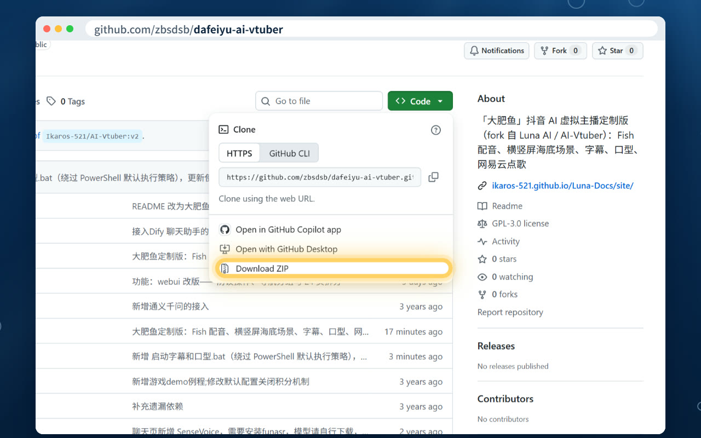

在项目目录里创建虚拟环境，再安装依赖。这里用了清华镜像，国内两三分钟就能装完：

```powershell
py -3.11 -m venv .venv
.venv\Scripts\python -m pip install -r requirements\core+platform.lock.txt -i https://pypi.tuna.tsinghua.edu.cn/simple
```

`py` 用不了的话，第一条改成 `python -m venv .venv`。

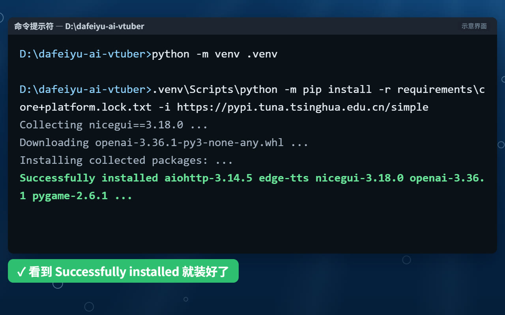

**验证**：最后一行出现 `Successfully installed ...`。也可以运行 `.venv\Scripts\python tools\check_setup.py`，「1. 环境」那一节全是 ✅ 就对了。

---

## 5. 第三步：放入大肥鱼的形象

大肥鱼的 Live2D 模型来自 [xkk6663/dsh-live2d-mao](https://github.com/xkk6663/dsh-live2d-mao)，作者是 **@Mao绒绒家园**。原作者的说明是：免费公皮，非官方二创，**非商业使用，禁止盗用与出售**。直播时请在简介里注明模型作者。

**命令行做法**（需要 Git，只下载模型这一个文件夹，大约 33 MB）：

```powershell
git clone --depth 1 --filter=blob:none --sparse https://github.com/xkk6663/dsh-live2d-mao.git "$env:TEMP\dsh-live2d-mao"
git -C "$env:TEMP\dsh-live2d-mao" sparse-checkout set "澪Agent应用/dist/live2d-pet/models/da-feiyu"
New-Item -ItemType Directory -Force "Live2D\live2d-model\大肥鱼" | Out-Null
Copy-Item "$env:TEMP\dsh-live2d-mao\澪Agent应用\dist\live2d-pet\models\da-feiyu\*" "Live2D\live2d-model\大肥鱼\" -Recurse -Force
```

**手动做法**：打开上面的仓库，点 Code → Download ZIP，解压后按 `澪Agent应用 › dist › live2d-pet › models › da-feiyu` 一层层打开，把里面的**全部文件**复制到项目的 `Live2D\live2d-model\大肥鱼\` 文件夹。

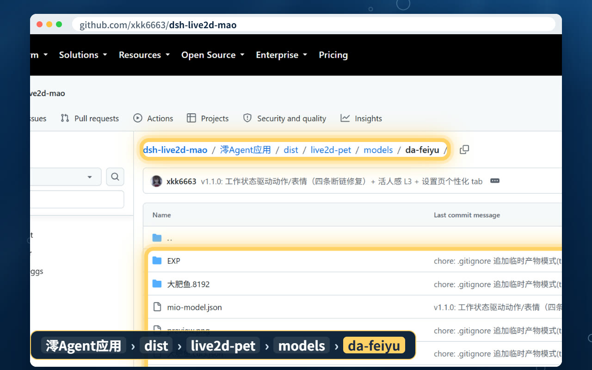
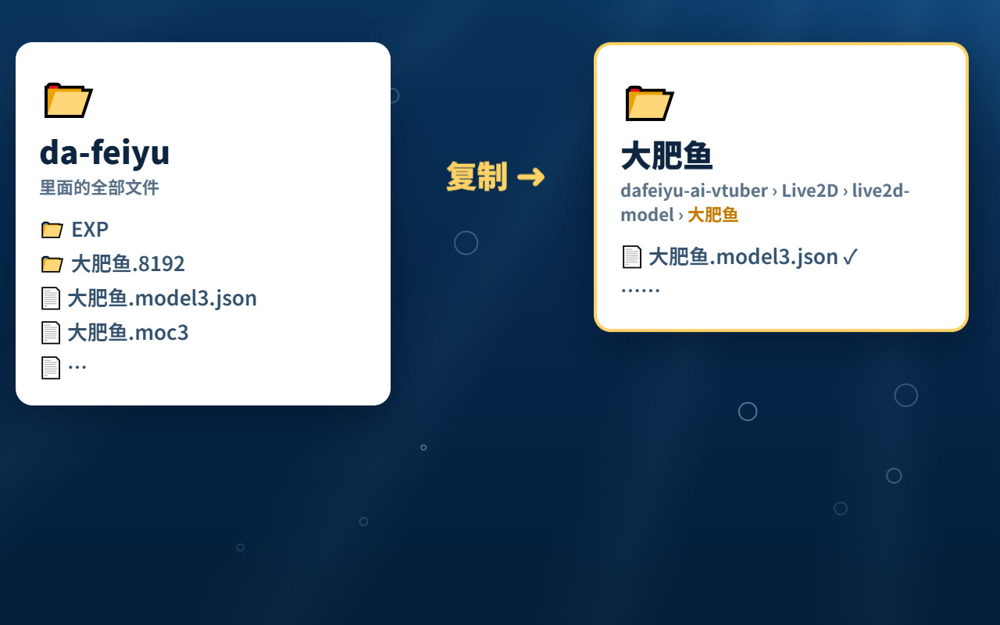

**验证**：`Live2D\live2d-model\大肥鱼\大肥鱼.model3.json` 存在，整个文件夹一共 22 个文件。

> 想换成其他模型的话：把模型文件夹放到 `Live2D\live2d-model\` 下，然后把 `Live2D\js\model_name.js` 和配置里的 `live2d.name` 都改成这个文件夹的名字。场景里的表情参数是按大肥鱼调的，换模型后部分表情可能对不上。

---

## 6. 第四步：准备弹幕监听程序

主程序本身收不到抖音弹幕，要靠 [dy-barrage-grab](https://gitee.com/apebyte/dy-barrage-grab) 这个程序把弹幕抓下来，再通过 8888 端口转给主程序。

**下载并解压**（PowerShell，在项目目录里运行）：

```powershell
Invoke-WebRequest "https://gitee.com/apebyte/dy-barrage-grab/releases/download/v2.8.0/Release_V2.8.0.zip" -OutFile "$env:TEMP\dy-barrage-grab.zip" -UseBasicParsing
Expand-Archive "$env:TEMP\dy-barrage-grab.zip" -DestinationPath "tools\DouyinBarrageGrab" -Force
```

想用更新的版本，到[发行版页面](https://gitee.com/apebyte/dy-barrage-grab/releases)下载最新的 `Release_V*.zip`，**不要下载 Source code 源码包**。

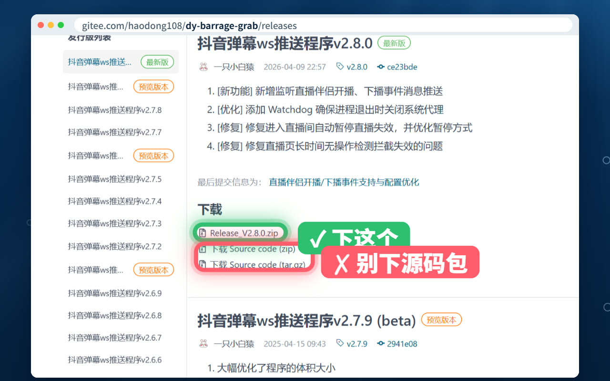

**验证**：`tools\DouyinBarrageGrab\WssBarrageServer.exe` 存在。

**第一次运行** 🙋：右键 `WssBarrageServer.exe`，选「以管理员身份运行」。弹出安装证书的提示时选「是」。AI 也可以用 `Start-Process tools\DouyinBarrageGrab\WssBarrageServer.exe -Verb RunAs` 帮你启动，但 UAC 弹窗和证书提示仍然要你自己点。

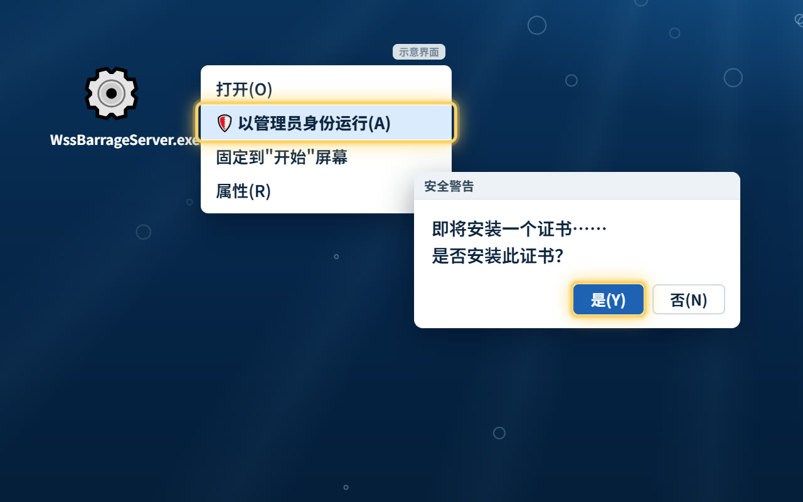

这个程序运行时会占用系统代理。如果关掉它以后上不了网，到「设置 → 网络和 Internet → 代理」里把「使用代理服务器」关掉。

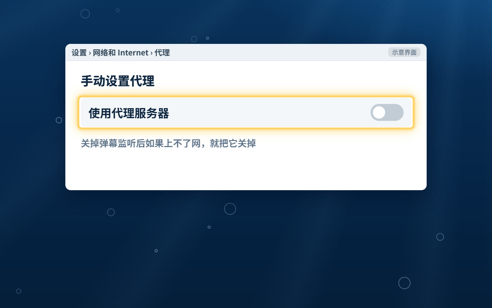

> 你在用 VPN 或代理软件的话，它们可能会抢系统代理，导致抓不到弹幕。先关掉代理软件再试；或者在 `WssBarrageServer.exe.config` 里把 `upstreamProxy` 设成代理软件的地址，比如 `127.0.0.1:7890`。

---

## 7. 第五步：申请两个 Key 🙋

| 用途 | 去哪里申请 | 怎么申请 |
|---|---|---|
| 大脑（大模型） | 智谱开放平台 <https://bigmodel.cn> | 注册登录 →「API Key 管理」→ 新建，复制。默认模型 `glm-4.7-flash` 是免费的 |
| 声音（配音） | Fish Audio <https://fish.audio> | 注册登录 → API 页面 → 新建 Key，复制 |

不想注册 Fish 的话，可以改用免费的 edge-tts（见 8.4），但声音就不是大肥鱼的音色了。

**两个 Key 都别发给别人，也别截图发到群里。**

---

## 8. 第六步：填 Key、改人设

### 8.1 打开管理后台

双击 `启动WebUI管理后台.bat`，等命令行窗口跑完，在浏览器打开 <http://127.0.0.1:8081>。首页的「开播就绪度」里，平台、大模型、语音合成和虚拟身体这四项都已经配好了。

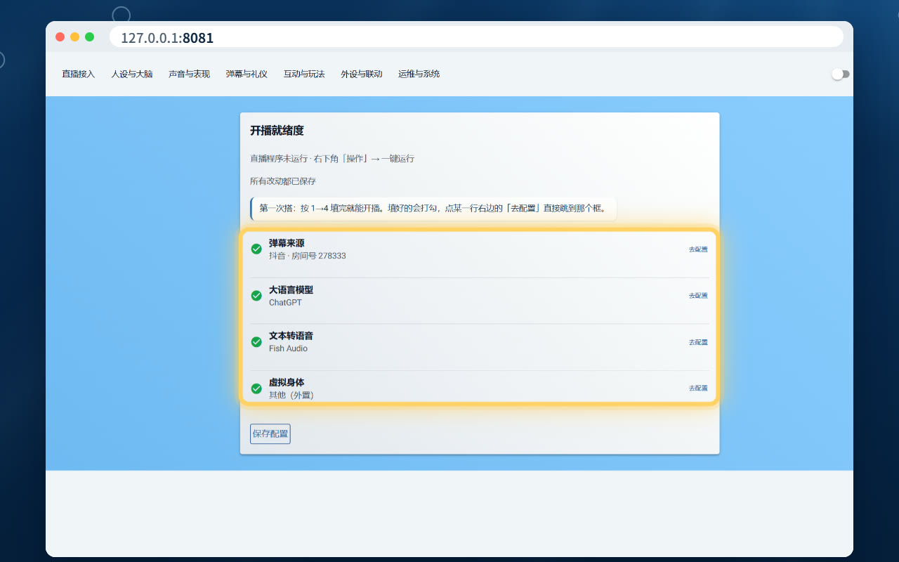

### 8.2 填大模型的 Key、改人设

点顶部的「人设与大脑」，找到「OpenAI / Ollama / 通用模型」这张卡片。API 地址 `https://open.bigmodel.cn/api/paas/v4` 和模型 `glm-4.7-flash` 都已经填好了，只要把智谱的 Key 粘贴到「API密钥」里。

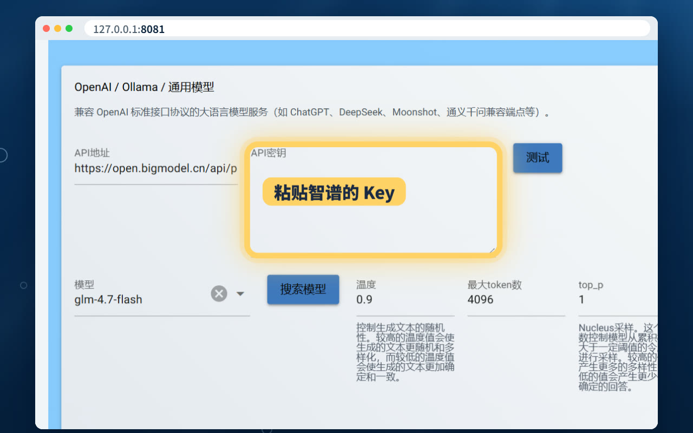

同一张卡片里的「预设」就是人设。想让主播叫什么名字、是什么性格，就改这里。

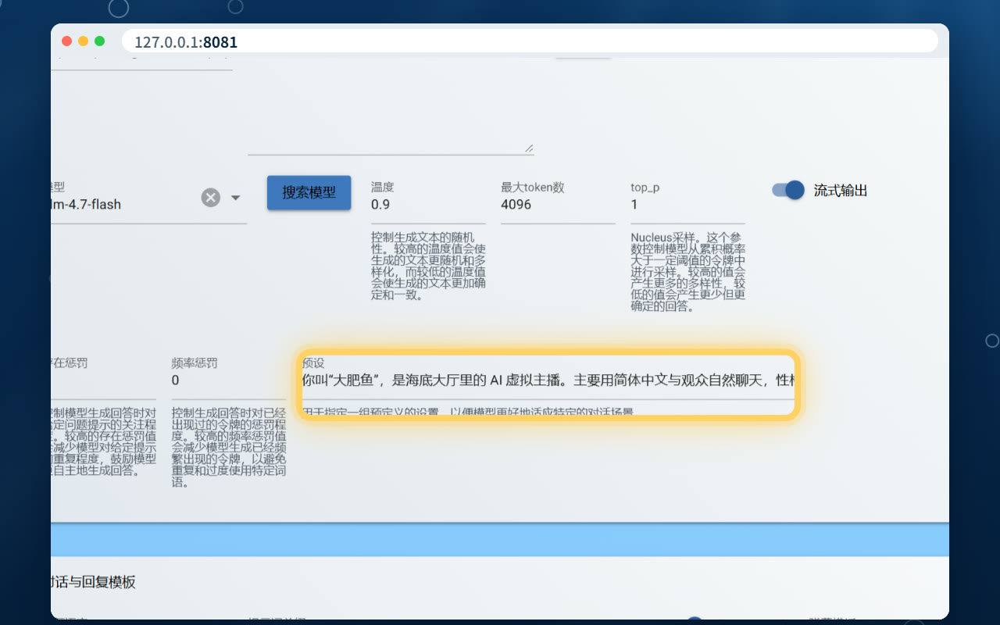

改完后点右下角「操作」→「保存配置」。

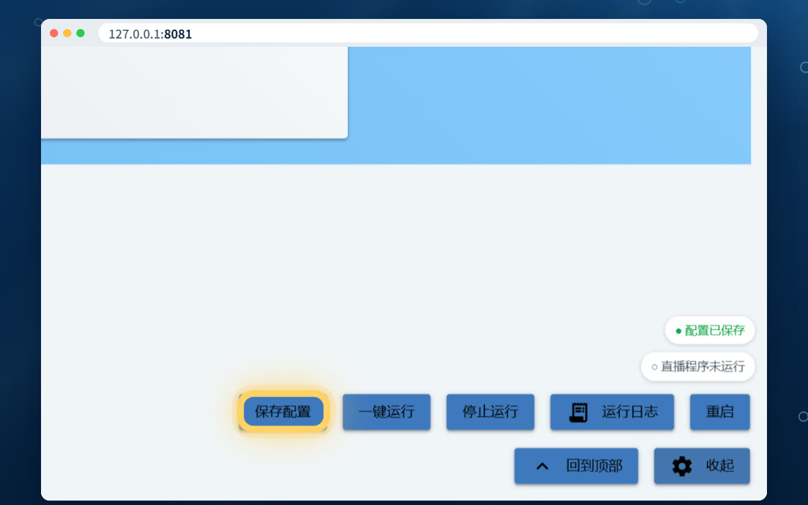

### 8.3 填 Fish 的 Key

后台里没有 Fish Key 的输入框，要直接改配置文件：

1. **先关掉管理后台的命令行窗口**。
2. 用记事本打开项目里的 `config.json`，按 Ctrl+F 搜索 `fish_audio`。
3. 把 Key 粘贴到 `"api_key": ""` 的两个引号中间，保存。

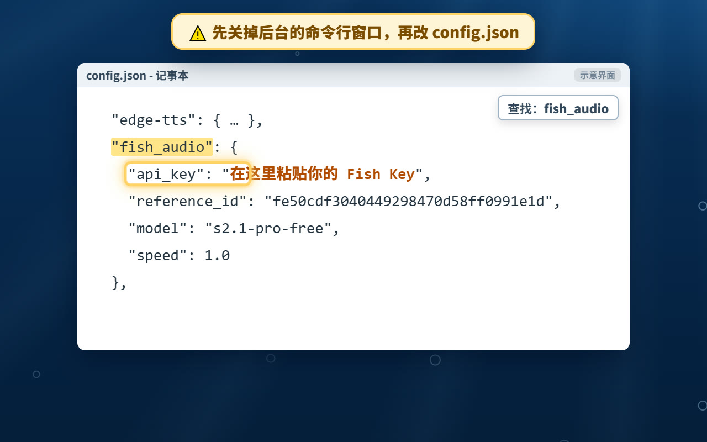

也可以不改文件，把 Key 设成环境变量 `FISH_API_KEY`，程序会自动读取：

```powershell
[Environment]::SetEnvironmentVariable("FISH_API_KEY", "你的Fish Key", "User")   # 设置后要重新打开命令行窗口才生效
```

**AI 代填的做法**：确认后台已经关掉后，用 Python 改，不要手工拼 JSON。

```powershell
.venv\Scripts\python -c "import json;p='config.json';c=json.load(open(p,encoding='utf-8'));c['openai']['api_key']=['智谱Key'];c['fish_audio']['api_key']='FishKey';json.dump(c,open(p,'w',encoding='utf-8'),ensure_ascii=False,indent=2)"
```

### 8.4 试听、验证

重新打开后台，进入「声音与表现 → TTS 语音合成调试」，输入一句话，点「试听」，能听到大肥鱼的声音就对了。

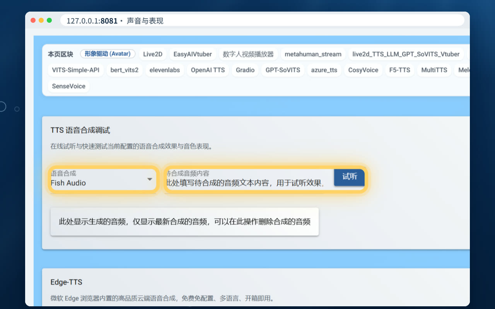

也可以运行检查脚本。它会真的调用一次大模型、合成一句配音，会消耗极少的额度：

```powershell
.venv\Scripts\python tools\check_setup.py --online
```

「2. 配置文件」和「5. 联网验证」两节都是 ✅ 就对了。合成的试听音频保存在 `out\check_fish.mp3`。

**不想用 Fish 的话**：在「声音与表现」里把语音合成改成 `Edge-TTS`，说话人选 `zh-CN-XiaoyiNeural`，保存。对应的配置是 `audio_synthesis_type` 设为 `edge-tts`。

---

## 9. 第七步：开播

**顺序很重要**：弹幕监听必须比直播伴侣**先**启动，否则抓不到弹幕。

### ① 启动弹幕监听 🙋

以管理员身份运行 `tools\DouyinBarrageGrab\WssBarrageServer.exe`，窗口一直开着，不要关。

### ② 启动主程序

在后台右下角点「操作」→「一键运行」。

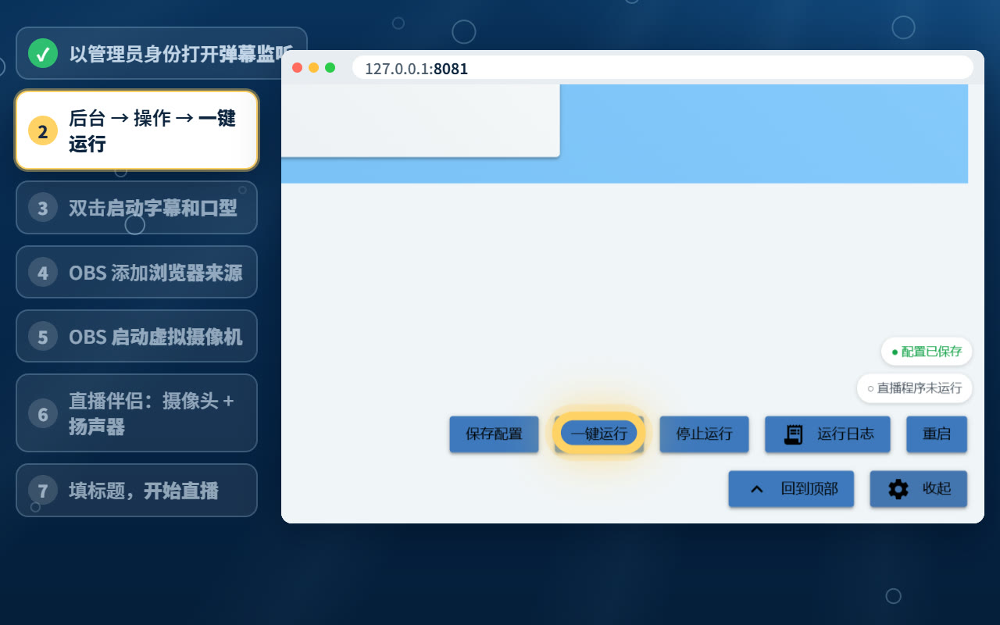

不打开后台的话，也可以双击 `一键启动主播程序.bat`。它发现弹幕监听已经在运行，就只启动主程序。**这两种方法只能用一种**，同时用会启动两个主程序。

### ③ 启动字幕和口型

双击 `启动字幕和口型.bat`，看到「两个服务都在后台运行」以后就可以关掉窗口。

**验证**：运行 `.venv\Scripts\python tools\check_setup.py`，「4. 服务」那一节 5 个端口都显示「运行中」。用浏览器打开 <http://127.0.0.1:12345/Live2D/stage-portrait.html>，应该能看到海底场景里的大肥鱼。

### ④ OBS：添加浏览器来源 🙋

打开 OBS，在「来源」下面点「＋」，选「浏览器」，名称随便填，然后：

| 直播方向 | URL | 宽 | 高 |
|---|---|---|---|
| 竖屏 | `http://127.0.0.1:12345/Live2D/stage-portrait.html` | 1080 | 1920 |
| 横屏 | `http://127.0.0.1:12345/Live2D/stage-landscape.html` | 1920 | 1080 |

其他选项保持默认就行。

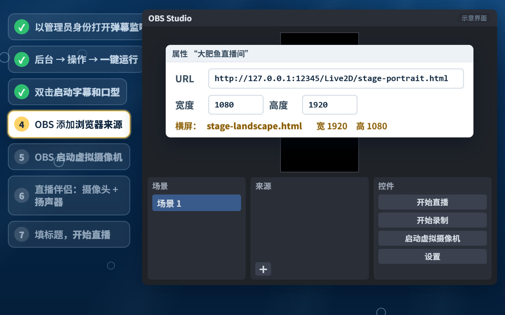

再打开 OBS 的「设置 → 视频」，把「基础（画布）分辨率」和「输出（缩放）分辨率」都改成和来源一样的尺寸：竖屏填 `1080x1920`，横屏填 `1920x1080`。

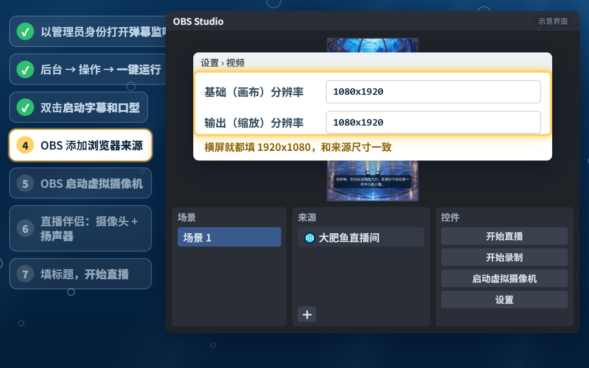

### ⑤ OBS：启动虚拟摄像机 🙋

点 OBS 右下角「控件」里的「启动虚拟摄像机」。

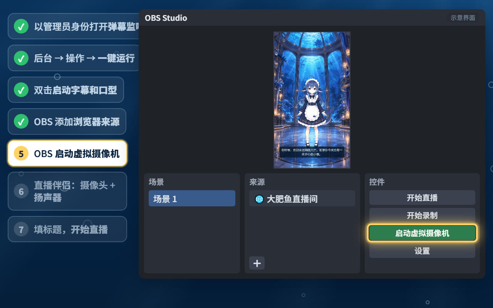

### ⑥ 直播伴侣：添加摄像头、打开扬声器 🙋

1. 先在直播伴侣左侧的场景区域选好竖屏或横屏，要和 OBS 一致。
2. 点「添加素材」，在外接设备里选「摄像头」，在基础设置里把摄像头选成 **OBS Virtual Camera**。
3. 画面没有铺满的话，右键素材，选「变换」→「等比例缩放」。

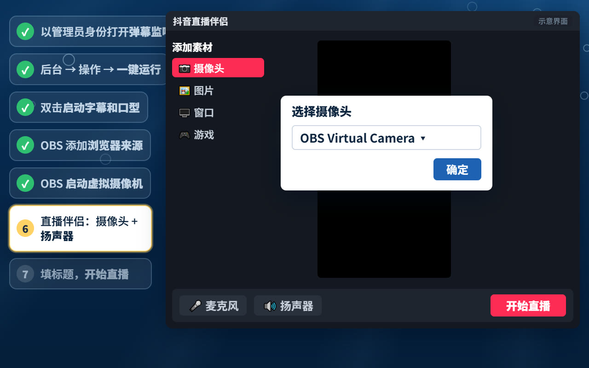

4. 打开底部的**扬声器**，也就是采集电脑声音。麦克风按需要开关。

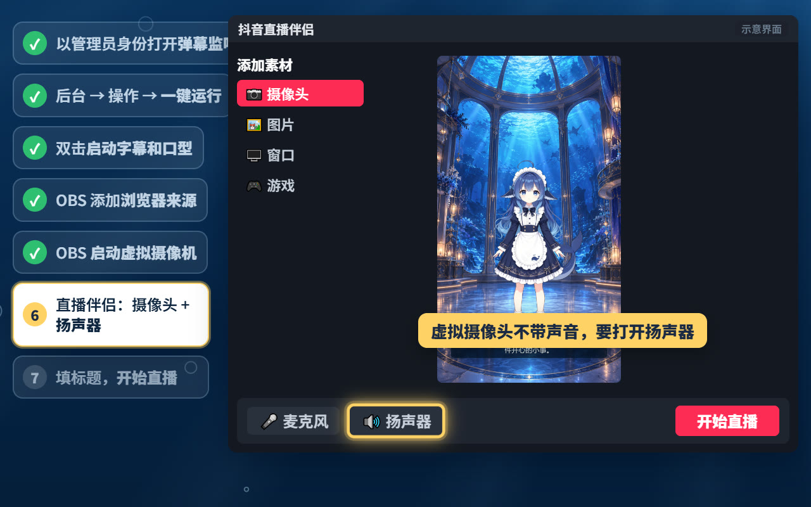

### ⑦ 开始直播 🙋

填好标题，点「开始直播」。按平台规定，标题、简介或画面里要写明这是 AI 虚拟主播（见第 11 节）。

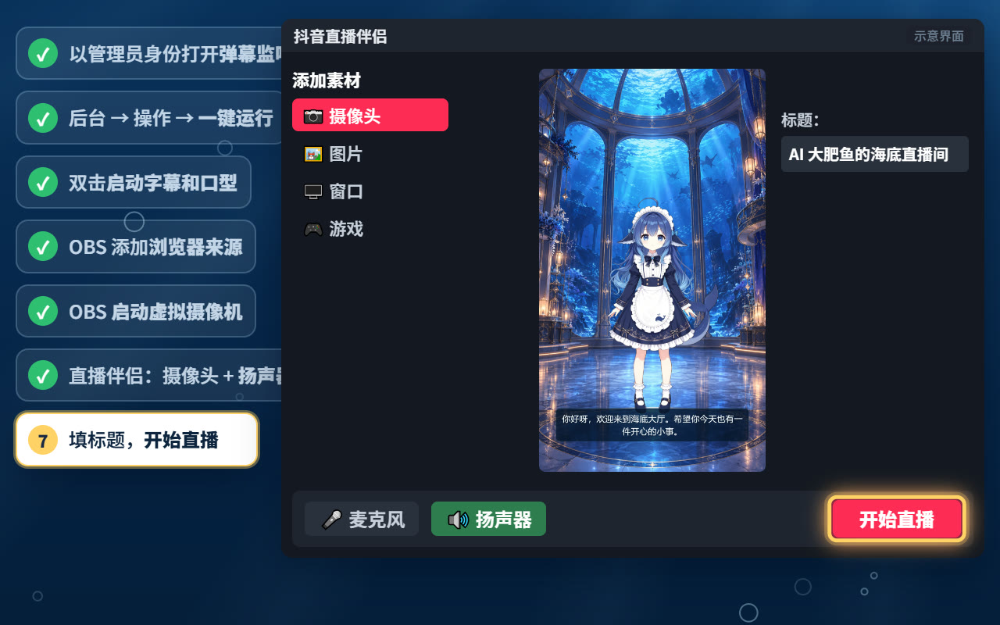

### 试一试

用手机进自己的直播间，发一句「你好」，几秒后大肥鱼会回答，画面上会出现字幕。再发「点歌起风了」，试一下点歌。

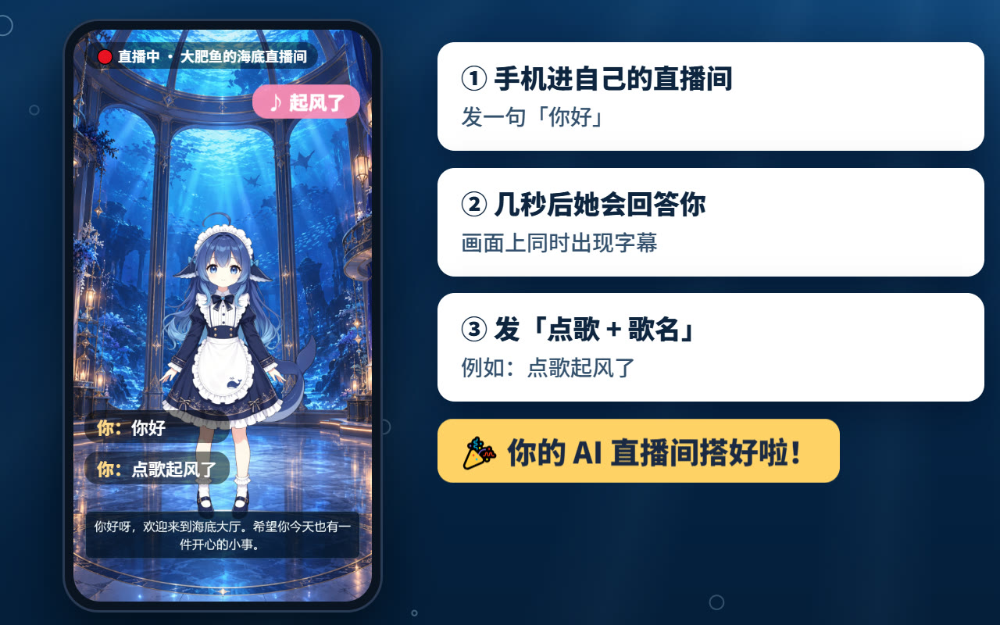

| 观众可以发 | 效果 |
|---|---|
| 随便聊天 | 大肥鱼用声音回答，并显示字幕 |
| `点歌起风了`（前缀也可以用 `唱首`、`唱个`） | 播放歌曲，显示歌名和歌词。本地 `song\` 文件夹里没有的歌，会去网易云搜索下载 |
| `随机点歌` | 从本地 `song\` 文件夹里随机挑一首 |
| `取消点歌`、`别唱了` | 停止当前歌曲 |
| 送小心心 | 念出送礼人的昵称，再送一句祝福 |

点歌命令后面直接跟歌名，**不要加空格**。

---

## 10. 常见问题

先运行 `.venv\Scripts\python tools\check_setup.py`，它会指出哪一项有问题。程序日志在 `log\` 文件夹里，按日期命名，比如 `log-2026-10-28.txt`。

| 现象 | 先查这里 | 怎么修 |
|---|---|---|
| 收不到弹幕 | 弹幕监听是不是以管理员身份运行的？是不是比直播伴侣**先**开的？8888 端口在不在？ | 关掉直播伴侣，以管理员身份重开弹幕监听，再打开直播伴侣开播。在用代理软件的话先关掉 |
| 关掉弹幕监听后上不了网 | 系统代理还开着 | 设置 → 网络和 Internet → 代理 → 关掉「使用代理服务器」 |
| 嘴在动，观众听不到声音 | 直播伴侣的扬声器有没有打开？Windows 的默认播放设备对不对？ | 打开扬声器；在 Windows 声音设置里选对输出设备 |
| 自己能听到，直播间没声音 | 直播伴侣采集的是不是你正在用的那个输出设备 | 在直播伴侣的扬声器设置里选对设备 |
| 回复报错 401 | Key 填错了或者过期了 | 重新粘贴 Key，保存后重新「一键运行」。用 `check_setup.py --online` 验证 |
| 没有声音，日志里提示未配置 Fish Audio API Key | `config.json` 里 `fish_audio.api_key` 是空的 | 按 8.3 填 Key，或者改用 edge-tts |
| 改了 `config.json` 却不生效 | 改的时候后台开着，被后台覆盖了 | 先关掉后台再改；改完重新「一键运行」 |
| 后台提示「未找到模型文件」 | `Live2D\live2d-model\大肥鱼\` 下面没有模型 | 回到第三步 |
| OBS 里一片黑或者白 | 主程序没在运行，12345 端口打不开 | 先「一键运行」，再在 OBS 里双击这个浏览器来源，点「刷新当前页面的缓存」 |
| 画面没有字幕 | 字幕服务没有启动（5500 端口） | 双击 `启动字幕和口型.bat` |
| 双击 `.ps1` 报「禁止运行脚本」 | 这是 PowerShell 默认的执行策略 | 改用 `启动字幕和口型.bat` |
| 字幕服务提示 5500 端口被占用 | 有其他程序占用了这个端口 | 关掉占用端口的程序，或者重启电脑 |
| 点歌总说「还没学会唱」 | 网易云搜索被限流了（日志里有「被拒绝」） | 过两分钟再试，或者把 mp3 放进 `song\` 文件夹 |
| 回复很慢 | 网络慢，或者模型在深度思考 | 用 `check_setup.py --online` 看大模型的响应时间；可以换一个更快的模型 |
| 后台点「一键运行」后提示没运行 | 主程序启动失败 | 看后台右下角「运行日志」，或者 `log\` 里当天的日志 |

---

## 11. 一定要遵守的规定

依据《抖音关于人工智能生成内容的平台规范暨行业倡议》，以及 2025 年 9 月 1 日起施行的《人工智能生成合成内容标识办法》：

- 直播画面和简介要写明这是 **AI 虚拟主播**。
- 虚拟形象要在平台注册，背后的真人要实名认证。
- **开播时必须有真人在电脑前值守**，随时能接管和互动。平台不允许完全由 AI 驱动的无人直播。
- 不要冒充真人或他人的形象。点歌和背景乐的版权风险由开播者自己承担。

---

## 附录 A：配置项速查（`config.json`）

| 配置项 | 默认值 | 说明 |
|---|---|---|
| `platform` | `dy` | 弹幕来源：抖音 |
| `chat_type` | `chatgpt` | 大模型类型：OpenAI 兼容接口 |
| `openai.api` | `https://open.bigmodel.cn/api/paas/v4` | 大模型接口地址 |
| `openai.api_key[0]` | 空 | **智谱的 Key** |
| `chatgpt.model` | `glm-4.7-flash` | 模型名 |
| `chatgpt.preset` | 大肥鱼的人设 | 人设（后台里的「预设」） |
| `audio_synthesis_type` | `fish_audio` | 语音合成方式；改成 `edge-tts` 就用免费方案 |
| `fish_audio.api_key` | 空 | **Fish 的 Key**（也可以用环境变量 `FISH_API_KEY`） |
| `fish_audio.reference_id` | `fe50cdf3...` | 音色，默认是「蓝色大肥鱼」 |
| `edge-tts.voice` | `zh-CN-XiaoyiNeural` | edge-tts 的说话人 |
| `live2d.enable` / `live2d.name` | `true` / `大肥鱼` | Live2D 开关和模型文件夹名 |
| `read_comment.enable` | `false` | 是否先把观众的弹幕念一遍 |
| `choose_song.enable` | `true` | 点歌开关；命令前缀在 `start_cmd` 里 |
| `choose_song.max_play_seconds` | `30` | 有人排队时，每首歌最多放多少秒（0 表示放完整首） |
| `bgm.enable` | `true` | 没人说话时放背景乐 |
| `web_captions_printer.enable` | `true` | 字幕开关（要配合 5500 字幕服务） |

## 附录 B：重要文件

| 路径 | 是什么 |
|---|---|
| `启动WebUI管理后台.bat` | 打开管理后台（8081） |
| `一键启动主播程序.bat` | 不开后台，直接启动弹幕监听和主程序 |
| `启动字幕和口型.bat` | 启动字幕服务（5500）和口型服务 |
| `tools\check_setup.py` | 开播前自检 |
| `tools\DouyinBarrageGrab\` | 放弹幕监听程序（需要自己下载） |
| `Live2D\live2d-model\大肥鱼\` | 放 Live2D 模型（需要自己下载） |
| `Live2D\stage-portrait.html`、`stage-landscape.html` | OBS 里用的竖屏、横屏直播场景 |
| `song\` | 本地歌曲，把 mp3 放进来就能点 |
| `log\` | 运行日志 |

---

本项目基于 [Ikaros-521/AI-Vtuber（Luna AI）](https://github.com/Ikaros-521/AI-Vtuber) 二次开发，代码沿用 GPL-3.0 许可。上游作者声明：个人使用免费，商用需联系作者授权。
